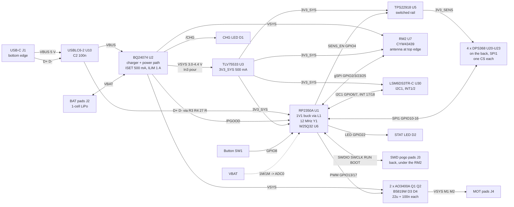

# Architecture — bluebuzz-rm2

Every block is one region of the single generated schematic sheet (`scripts/gen_schematic.py` `blk_*`) and one placement region (`scripts/place.py`):

| Block | Parts | Schematic block | Board region |
|---|---|---|---|
| USB-C + ESD | J1, U10, C2, R1, R2, R3, R4 | blk_usb | bottom-right (R3/R4 at the MCU's USB pins) |
| Charger | U2, R10-R13, C10-C15, D1, R14, J2 | blk_charger | top-left |
| LDO | U3, C20-C22 | blk_ldo | left, below the charger |
| Switched rail | U5, C50-C52, R50 | blk_sense | left, below the LDO |
| Motors | Q1, Q2, R40-R43, D3, D4, C40-C43, J4 | blk_motor | bottom-left |
| Tactile array | U20-U23, C120-C123 | blk_tactile | back, left of centre |
| IMU | U30, C130-C132, R130, R131 | blk_imu | left edge, middle |
| Host | U1, L1, C80-C96, R84, R85, Y1, C86, C87, R86, U6, C88, R87, R88, C89, R60, R61, C64, J3 | blk_mcu, blk_flash, blk_swd | centre-right |
| Radio | U7, R80, R81, C100-C102 | blk_radio | top-right |
| UI | SW1, D2, R62 | blk_ui | left edge, bottom |
